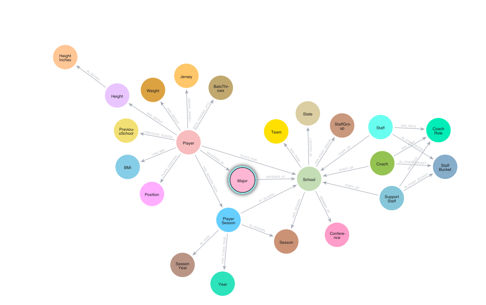
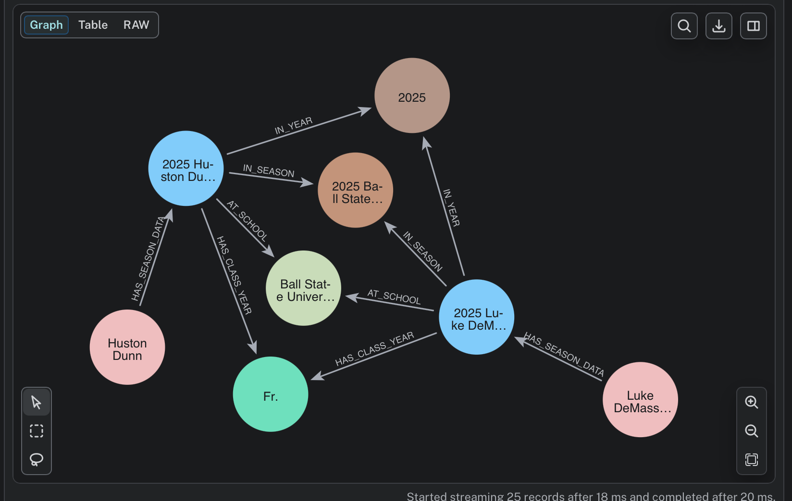
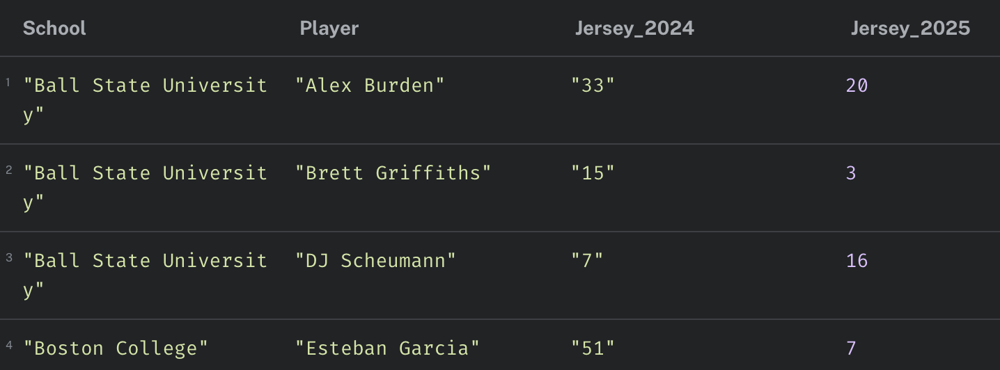
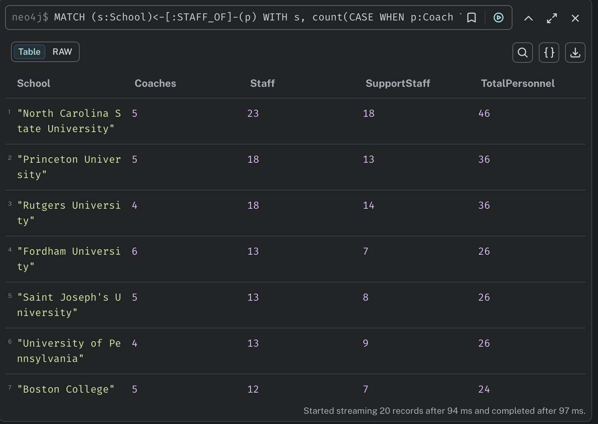
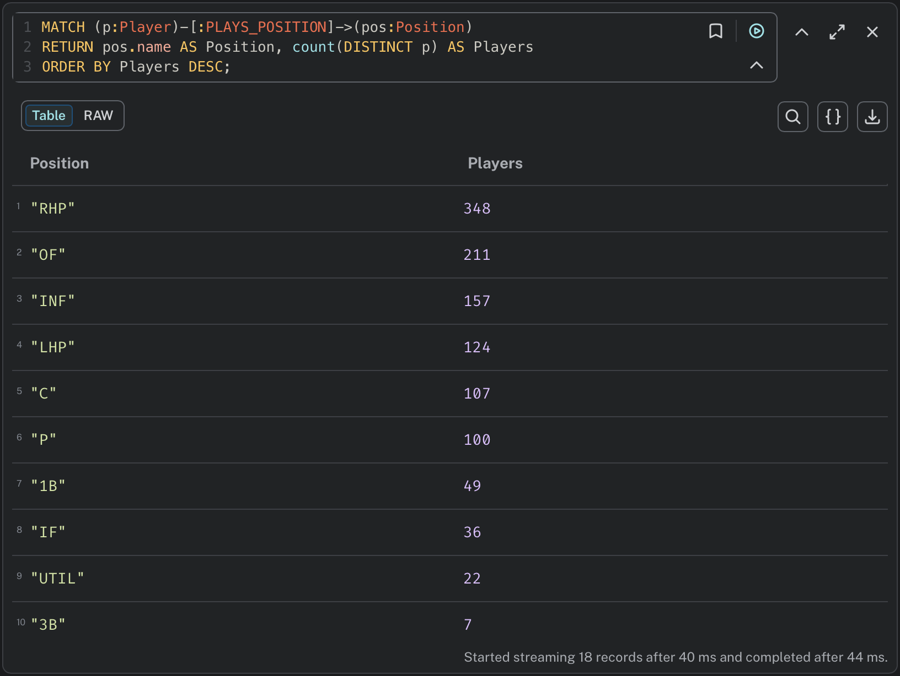
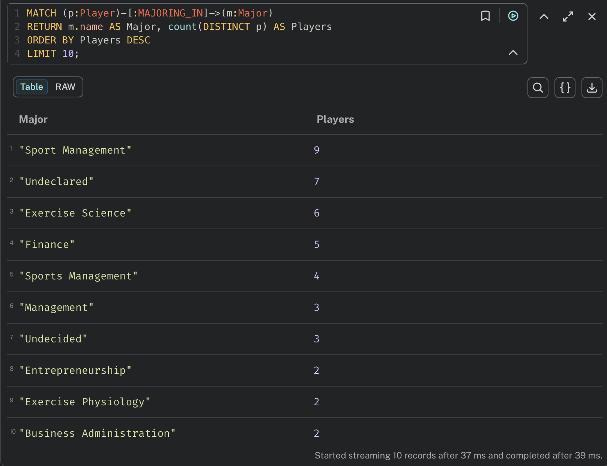
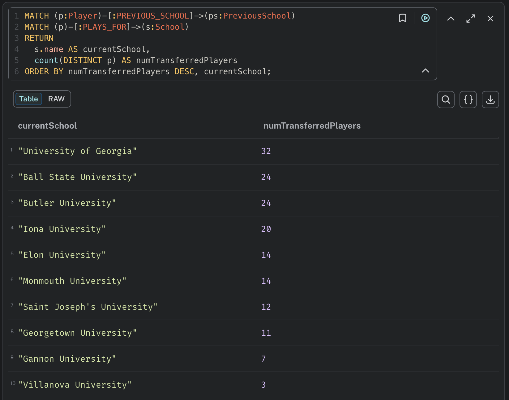

# DiamondKG: College Baseball Knowledge Graph (Neo4j)

DiamondKG is a **Neo4j knowledge graph** built from the official roster and staff pages of **20 U.S. college baseball programs**. A Python ETL pipeline scrapes inconsistent athletics websites, normalizes the data into one schema, and loads it into Neo4j. Players, schools, staff and seasons become a single graph you can query.

The graph covers **two seasons (2024 and 2025)**. It uses a **reified `PlayerSeason` node**, so season-specific details like jersey, position, weight and class year are tracked over time without duplicating players.

| | |
|---|---|
| Universities | 20 |
| Seasons | 2024, 2025 |
| Player records | 700+ per season |
| Staff records | 194 (coaches, program staff, support staff) |
| Graph size | **3,480 nodes · 14,668 relationships** |



---

## The problem

Roster data is public, but every school publishes it differently:

- **Different column names:** `#`, `No.`, `Number` / `Pos.`, `Position` / `Yr.`, `Class`, `Academic Year`
- **Different formats:** heights written as `6-3`, `6'3`, `6' 3"`; combined fields like `Hometown / High School`
- **Different page structures:** some pages include ad rows ("Skip Ad", "Team Impact") inside the roster table
- **Mixed staff pages:** coaches, operations staff and athletic trainers all listed together

Comparing rosters across schools in a spreadsheet isn't practical. A knowledge graph gives every school the same structure and makes cross-program questions easy to ask.

## Pipeline

```
Discovery ──► Extraction ──► Normalization ──► Entity resolution ──► Publish ──► Load ──► QA
 roster &      requests +     canonical          deterministic IDs,     CSV on     Neo4j    consistency
 staff URLs    pandas         columns, height,   PlayerSeason keys      GitHub     AuraDB   queries
 per school    read_html      position, year                            Gist (raw)
```

1. **Discovery:** a per-school config maps each university to its roster and coaches URLs.
2. **Extraction:** pages are fetched with `requests` and parsed with `pandas.read_html`. A heuristic picks the main roster table (the largest by rows × columns).
3. **Normalization:**
   - A **canonical column map** turns 30+ header variants into one schema (`jersey`, `name`, `year`, `position`, `bats_throws`, `height`, `weight`, `hometown`, `high_school`, `previous_school`, `major`)
   - Combined `Hometown / High School` and `Hometown / Previous School` fields are split
   - Heights are normalized to feet'inches, and numeric inches are derived for comparisons
   - Composite positions are split (`IF/RHP` → `IF`, `RHP`), and class years are cleaned (`R-Fr.` → `FR`)
   - Jersey and weight are type-coerced, and ad or junk rows are removed
4. **Entity resolution:** deterministic IDs and uniqueness constraints keep every school, player and season snapshot unique.
5. **Publish:** clean CSVs are hosted on GitHub Gist, so Neo4j can import them from a stable raw URL.
6. **Load:** idempotent `MERGE`-based imports mean the pipeline can be **re-run without creating duplicates**.
7. **QA:** baseline queries confirm that counts, distributions and links stay consistent after each schema change.

## Graph model

**Core nodes:** `School`, `Player`, `PlayerSeason`, `Season` / `Year`, `Team`, `Conference`, `State`

**Attribute nodes:** `Jersey`, `Position`, `Height`, `HeightInches`, `Weight`, `BMI`, `BatsThrows`, `Major`, `PreviousSchool`. Modeling these as nodes makes them shareable and easy to aggregate, for example "players by position" or "top majors".

### Reification with `PlayerSeason`

Without reification, loading 2024 and 2025 together would overwrite data, because jerseys, positions, weights and class years change, and players transfer. Each `PlayerSeason` node represents *"this player, at this school, in this season"*. It holds the season-specific attributes, while `Player` stays a stable identity.



This makes it possible to track roster changes over time, such as jersey changes between seasons:



### Staff buckets

Athletics "staff" pages mix many roles. Storing everyone as `Coach` would inflate coach counts. Instead, a title-based classifier puts each person into one of three buckets, and the original title is kept for traceability:

| Bucket | Examples |
|---|---|
| `Coach` | Head Coach, Assistant Coach, Pitching Coach, Hitting Coach |
| `Staff` | Director of Operations, Recruiting Coordinator, Video, Equipment |
| `SupportStaff` | Athletic Trainer, Strength & Conditioning, Sports Performance |



## Example queries and results

More queries are in [`cypher/sample_queries.cypher`](cypher/sample_queries.cypher).

**Players by position**
```cypher
MATCH (p:Player)-[:PLAYS_POSITION]->(pos:Position)
RETURN pos.name AS Position, count(DISTINCT p) AS Players
ORDER BY Players DESC;
```


**Top majors**
```cypher
MATCH (p:Player)-[:MAJORING_IN]->(m:Major)
RETURN m.name AS Major, count(DISTINCT p) AS Players
ORDER BY Players DESC
LIMIT 10;
```


**Players with a previous school, by current program**
```cypher
MATCH (p:Player)-[:PREVIOUS_SCHOOL]->(ps:PreviousSchool)
MATCH (p)-[:PLAYS_FOR]->(s:School)
RETURN s.name AS currentSchool, count(DISTINCT p) AS numTransferredPlayers
ORDER BY numTransferredPlayers DESC, currentSchool;
```


## Universities covered

Ball State · Boston College · Brown · Bucknell · Butler · Cornell · Elon · Fordham · Gannon · Georgetown · Hofstra · Iona · Monmouth · NC State · Princeton · Rutgers · Saint Joseph's · Georgia · Penn · Villanova

## Repository structure

```
├── notebooks/
│   ├── 01_scrape_players_2025.ipynb          # 2025 rosters → normalized players CSV
│   ├── 02_scrape_players_2024.ipynb          # 2024 rosters (+ season, position split, class-year cleanup)
│   └── 03_scrape_coaches_and_schools.ipynb   # staff pages → coaches.csv, school.csv
├── cypher/
│   └── sample_queries.cypher                 # evaluation queries
├── docs/
│   └── DiamondKG_Final_Report.pdf            # full project report
├── images/                                   # schema and query screenshots
├── requirements.txt
└── README.md
```

## Data

The cleaned datasets are published as GitHub Gists and imported into Neo4j from their raw URLs:

- [Players 2025](https://gist.githubusercontent.com/suryaanarayanswamy/15221092033f6d38ef90bb8da2ab9484/raw/295d607fe45fc329739c58dfb89773701b935bef/playerss.csv)
- [Players 2024](https://gist.githubusercontent.com/suryaanarayanswamy/98c69ef01ec7416e245ed548727b3a68/raw/32118067e115276d8957de660361132a04f32467/player_2024.csv)
- [Coaches & staff](https://gist.githubusercontent.com/suryaanarayanswamy/7e627f174dca63d8022041bc4c6d9f9c/raw/ae57f9b5fd706ea3e69211f81f06d73e409b7dc1/coachess.csv)

## How to run

```bash
git clone https://github.com/suryaanarayanswamy/DiamondKG.git
cd DiamondKG
pip install -r requirements.txt
jupyter notebook
```

Run the notebooks in order. Each one writes a CSV to the working directory. Athletics websites change their layouts often, so some schools may need their URLs or column mappings updated before a re-run.

## Ethics and compliance

- Uses only **publicly available** information from official athletics websites
- Polite scraping: a descriptive User-Agent, request timeouts, no aggressive crawling, and respect for `robots.txt` and site terms
- Stores text facts only; images are kept as links, not downloaded
- Keeps provenance (`sourceUrl`, `retrievedAt`) for auditing and corrections

## Limitations and future work

- Page structures change, so per-school configuration needs ongoing maintenance
- `Major` and `PreviousSchool` are only available for some programs
- Planned: full 2024 + 2025 coverage for every school, season-aware conference membership, transfer-flow analysis between programs, and automated quality checks

## Tech stack

Python · pandas · requests · Neo4j (AuraDB) · Cypher · GitHub Gist · Jupyter

## Author

**Surya Narayan Swamy** · MS Computational Data Science, Temple University
[LinkedIn](https://www.linkedin.com/in/suryaanarayan/) · [GitHub](https://github.com/suryaanarayanswamy) · [Portfolio](https://surya-narayan.my.canva.site)
